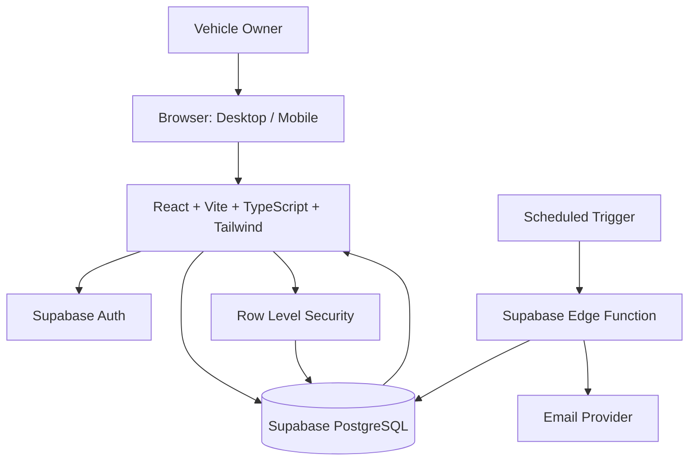

# 2. System Architecture Document

**Product:** VehicleCare  
**Version:** 1.0  
**Architecture style:** Responsive web client + managed backend platform + scheduled server-side processing

## 1. Architecture goals
- Keep the MVP simple enough for a first-time developer.
- Avoid maintaining a separate custom server unless a real requirement emerges.
- Separate presentation, data access, business rules and background processing.
- Enforce user ownership in the database, not only in the UI.
- Make scheduled reminders independent of an open browser.
- Keep external email delivery optional and replaceable.

## 2. Logical architecture

The diagram is logical. Actual Supabase scheduling configuration and email-provider integration must be verified during implementation.

## 3. Architecture components

### 3.1 Presentation layer
**Technology:** React, Vite, TypeScript, Tailwind CSS.

Responsibilities:
- Render pages and reusable UI components.
- Collect and validate user input for usability.
- Display vehicles, parts, schedules, history and notifications.
- Manage local UI state (dialogs, selected tabs, loading indicators).
- Call the Supabase client/service layer.
- Display errors and empty states.

The frontend must not contain service-role credentials or other privileged secrets.

### 3.2 Authentication
**Technology:** Supabase Auth.

Responsibilities:
- Register, sign in, sign out and password recovery.
- Provide an authenticated user identity.
- Maintain the session through the supported Supabase client.
- Link the authenticated user to a profile record.

Authentication proves who the user is. Authorization determines which records that user may access; authorization is enforced with RLS.

### 3.3 Data and persistence layer
**Technology:** Supabase PostgreSQL.

Responsibilities:
- Persist profiles, vehicles, components, schedules, maintenance history, odometer readings, notifications and preferences.
- Enforce primary keys, foreign keys, uniqueness and check constraints.
- Apply RLS to all user-owned tables.
- Support indexed queries for dashboards and reminder jobs.

### 3.4 Application/service layer
For the MVP, frontend service modules use the Supabase client for ordinary authenticated CRUD operations. Shared business calculations (date addition, due-state classification and validation) should live in isolated TypeScript modules with unit tests.

Privileged or scheduled operations belong in Edge Functions, not in browser code.

### 3.5 Background processing
**Technology:** Supabase Edge Functions with a supported scheduled trigger.

Responsibilities:
- Run at a defined cadence (initially daily).
- Find active warranty, lifecycle and maintenance events that match reminder windows.
- Create notification records.
- Use a unique deduplication key and database constraint to make retries safe.
- Attempt email delivery if enabled.
- Record delivery outcomes and execution errors.

The job must be safe to run more than once. It must not assume that a previous execution completed successfully.

### 3.6 Email delivery
Use a provider with a suitable free tier for development/demo. Provider selection is an implementation decision and must be checked for current free-tier quotas, sender verification and domain requirements.

Email is secondary to in-app notifications. If email delivery fails, the in-app reminder remains available.

## 4. Key data flows

### 4.1 Registration and login
1. User submits credentials in the React UI.
2. Supabase Auth validates credentials.
3. Auth returns a session.
4. The client uses the authenticated session for database requests.
5. RLS policies restrict records to the authenticated user.

### 4.2 Register a vehicle
1. User opens the vehicle form.
2. Frontend validates required fields.
3. Authenticated client inserts a vehicle row.
4. Database policy checks ownership.
5. UI refreshes the vehicle list and displays confirmation.

### 4.3 Register a component
1. User selects one of their vehicles.
2. User enters component details and lifespan.
3. Frontend calculates a live preview of `expected_replacement_on` using a pure TypeScript helper (`calculateExpectedReplacementDate`).
4. On save, a PostgreSQL `BEFORE INSERT OR UPDATE` trigger on `parts` acts as the single authoritative calculation path and stores `expected_replacement_on` using the documented calendar-month addition and month-end clamping rule.
5. UI displays the persisted estimate and its assumptions.

To keep frontend previews and persisted database values consistent, both the TypeScript preview helper and the PostgreSQL trigger must implement the exact same month-end clamping rule and be verified against the same boundary test cases (month-end dates and leap years). The database trigger remains authoritative whenever `installed_on` or `expected_lifespan_months` is inserted or updated.

### 4.4 Complete maintenance
1. User records the completed service date and optional odometer.
2. System inserts a maintenance record.
3. Related schedule is updated with last-completed and next-due values.
4. Historical record remains available.
5. Future reminder evaluation uses the updated schedule.

Use a database transaction/RPC or a carefully designed server-side operation if multiple related writes must succeed together.

### 4.5 Scheduled reminder processing
1. Scheduler invokes the reminder Edge Function.
2. Function reads eligible records using server-side credentials.
3. Function computes matching reminder events.
4. Function inserts notification rows using a unique deduplication key.
5. Duplicate-key conflicts are treated as already processed, not as fatal errors.
6. If email is enabled, function sends email and updates delivery status.
7. Function logs counts and failures without logging sensitive credentials.

## 5. Domain logic boundaries
- **Lifecycle calculation:** installation date + user-entered lifespan months.
- **Warranty calculation:** compare warranty expiry date with current local date.
- **Calendar maintenance:** compare next due date with reminder offsets.
- **Distance maintenance:** compare latest odometer with next due kilometre value.
- **Notification generation:** server-side scheduled operation.
- **Actual mechanical condition:** not determined by VehicleCare.

## 6. Date and time strategy
- Store calendar-only values (installation date, warranty date, service date, due date) as PostgreSQL `DATE`.
- Store event timestamps (created_at, sent_at, recorded_at) as `TIMESTAMPTZ`.
- Store a user timezone (IANA identifier such as `Asia/Kolkata`) in profile.
- Do not convert a date-only value through UTC in a way that shifts the displayed calendar day.
- Use a documented month-addition rule for dates at month-end. Recommended: clamp to the final valid day of the target month (e.g. Jan 31 + 1 month => Feb 28/29).
- Scheduled jobs should calculate date windows consistently and test timezone boundaries.

## 7. Deployment architecture
- Frontend: Vercel or another static hosting provider.
- Backend services: Supabase project.
- Source control: GitHub.
- Environment variables: local `.env.local` and hosting environment configuration.
- Never commit `.env.local`.
- Apply database migrations before deploying frontend features that depend on them.
- Configure scheduled function secrets only in Supabase/server-side secret management.

## 8. Scalability and future extension
The MVP should use clear boundaries so that later additions (service-centre accounts, document uploads, verified manufacturer data, diagnostic integrations) do not require rewriting the core ownership model. Do not build these future features prematurely.

## 9. Architecture risks
| Risk | Mitigation |
|---|---|
| Incorrect user-entered values | Clear labels, validation and editable records |
| Date/time off-by-one errors | DATE for date-only data; timezone-aware tests |
| Duplicate scheduled reminders | Unique dedupe key and idempotent insert |
| Email provider outage | Preserve in-app notifications; retry policy |
| Unauthorized data access | RLS, negative security tests |
| Free-tier quota changes | Check current limits before deployment |
| Incorrect mechanical assumptions | No universal lifespan claims; user-supplied estimates |
