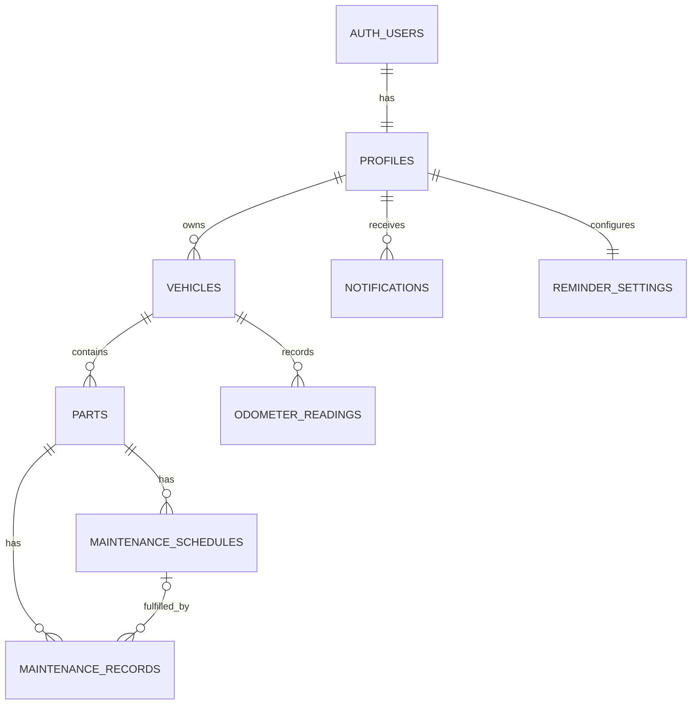

# 3. Database Design Document

**Database:** PostgreSQL on Supabase  
**Version:** 1.0  
**Design status:** Proposed schema; validate with migrations and RLS tests before production

## 1. Conventions
- Primary keys: UUID, generated by the database.
- Foreign keys: explicit references with documented delete behavior.
- Date-only fields: `DATE`.
- Event timestamps: `TIMESTAMPTZ`.
- Money: `NUMERIC(10,2)` with non-negative validation.
- Distance: integer kilometres.
- Text status values: constrained by CHECK constraints or PostgreSQL ENUMs. For a student MVP, CHECK constraints are acceptable and easier to evolve.
- Every user-owned data path must be protected by RLS.

## 2. Entity relationship diagram

## 2.1 Eight-table summary and relationships

| Table | Purpose | Primary Relationships |
|---|---|---|
| `profiles` | Stores user display name and timezone preferences linked to authentication identity. | 1:1 with `auth.users(id)`; 1:N with `vehicles`, `notifications`; 1:1 with `reminder_settings`. |
| `vehicles` | Stores user-owned two-wheelers and four-wheelers, optional registration info, archival state, and cached latest odometer reading. | N:1 to `profiles(id)`; 1:N with `parts`, `odometer_readings`. |
| `parts` | Stores vehicle components, installation/purchase details, independent warranty dates, user-entered lifespan, derived replacement estimate, and lifecycle status. | N:1 to `vehicles(id)`; 1:N with `maintenance_schedules`, `maintenance_records`; optional self-reference `replaced_by_part_id` -> `parts(id)`. |
| `maintenance_schedules` | Stores recurring calendar (`DATE_INTERVAL`) or distance (`ODOMETER_INTERVAL`) maintenance rules per component. | N:1 to `parts(id)`; 1:N optional reference from `maintenance_records`. |
| `maintenance_records` | Preserves immutable historical records of completed services, repairs, inspections, and replacements. | N:1 to `parts(id)`; optional N:1 to `maintenance_schedules(id)`. |
| `odometer_readings` | Append-only historical audit log of vehicle odometer readings in kilometres (source of truth for current odometer). | N:1 to `vehicles(id)`. |
| `notifications` | Stores generated in-app reminder notifications, read state, email delivery tracking, and database-enforced `dedupe_key`. | N:1 to `profiles(id)`; optional N:1 to `parts(id)` and `maintenance_schedules(id)`. |
| `reminder_settings` | Stores per-user notification channel toggles and configurable day/kilometre reminder offsets. | 1:1 with `profiles(id)` (`user_id` as PK/FK). |

## 3. Tables

### 3.1 profiles
| Column | Type | Rules |
|---|---|---|
| id | UUID | PK; references `auth.users(id)` |
| full_name | TEXT | nullable or required by product decision |
| timezone | TEXT | NOT NULL; default `Asia/Kolkata` |
| created_at | TIMESTAMPTZ | NOT NULL; default now() |
| updated_at | TIMESTAMPTZ | NOT NULL; default now() |

Create a profile when an Auth user is created, using a secure database trigger or an explicit trusted workflow. Test trigger failure and account deletion behavior.

### 3.2 vehicles
| Column | Type | Rules |
|---|---|---|
| id | UUID | PK |
| user_id | UUID | NOT NULL; FK profiles(id) |
| vehicle_type | TEXT | NOT NULL; `TWO_WHEELER` or `FOUR_WHEELER` |
| brand | TEXT | NOT NULL |
| model | TEXT | NOT NULL |
| registration_number | TEXT | nullable |
| manufacture_year | SMALLINT | nullable; sensible range |
| purchase_date | DATE | nullable |
| current_odometer_km | INTEGER | optional cached value; non-negative |
| is_archived | BOOLEAN | NOT NULL; default false |
| created_at | TIMESTAMPTZ | NOT NULL |
| updated_at | TIMESTAMPTZ | NOT NULL |

Constraints:
- If registration_number is supplied, normalize whitespace/case before uniqueness checking.
- Prefer a unique index on `(user_id, normalized_registration_number)` for non-null values.
- `odometer_readings` is the historical source of truth for odometer values. `vehicles.current_odometer_km` is a cached convenience field that must be updated atomically (via database trigger on `odometer_readings` or transactional RPC) whenever readings are recorded or corrected, never by an unguarded separate client update.

### 3.3 parts
| Column | Type | Rules |
|---|---|---|
| id | UUID | PK |
| vehicle_id | UUID | NOT NULL; FK vehicles(id) |
| part_name | TEXT | NOT NULL |
| category | TEXT | nullable or controlled vocabulary |
| manufacturer | TEXT | nullable |
| installed_on | DATE | nullable initially; required to calculate lifecycle date |
| purchased_on | DATE | nullable |
| purchase_cost | NUMERIC(10,2) | nullable; >= 0 |
| warranty_start_on | DATE | nullable |
| warranty_expiry_on | DATE | nullable |
| expected_lifespan_months | INTEGER | nullable; > 0 if supplied |
| expected_replacement_on | DATE | nullable; derived |
| status | TEXT | NOT NULL; `ACTIVE`, `REPLACED`, `REMOVED` |
| notes | TEXT | nullable |
| replaced_by_part_id | UUID | nullable self-reference to parts(id), if used |
| created_at | TIMESTAMPTZ | NOT NULL |
| updated_at | TIMESTAMPTZ | NOT NULL |

Rules:
- `expected_replacement_on` is derived from `installed_on` and `expected_lifespan_months`.
- A PostgreSQL `BEFORE INSERT OR UPDATE` trigger on `parts` is the single authoritative calculation path for persisting `expected_replacement_on` (using calendar-month addition clamped to the last valid day of the target month). The frontend uses an identical pure TypeScript helper for live preview, verified against the same boundary test cases.
- Warranty dates are independent from expected replacement.
- Do not delete historical component rows when replacing a part.

### 3.4 maintenance_schedules
| Column | Type | Rules |
|---|---|---|
| id | UUID | PK |
| part_id | UUID | NOT NULL; FK parts(id) |
| schedule_name | TEXT | NOT NULL |
| schedule_type | TEXT | NOT NULL; `DATE_INTERVAL` or `ODOMETER_INTERVAL` |
| interval_months | INTEGER | nullable; > 0 for date schedule |
| interval_km | INTEGER | nullable; > 0 for distance schedule |
| last_completed_on | DATE | nullable |
| last_completed_odometer_km | INTEGER | nullable; >= 0 |
| next_due_on | DATE | nullable |
| next_due_odometer_km | INTEGER | nullable; >= 0 |
| is_active | BOOLEAN | NOT NULL; default true |
| created_at | TIMESTAMPTZ | NOT NULL |
| updated_at | TIMESTAMPTZ | NOT NULL |

Constraints:
- For `DATE_INTERVAL`, require `interval_months > 0`; distance fields may be null.
- For `ODOMETER_INTERVAL`, require `interval_km > 0`; date interval fields may be null.
- Do not allow a schedule with both interval types unless a future requirement explicitly defines combined “whichever comes first” behavior.
- The first due point must be provided or derived from a documented starting point.

### 3.5 maintenance_records
| Column | Type | Rules |
|---|---|---|
| id | UUID | PK |
| part_id | UUID | NOT NULL; FK parts(id) |
| schedule_id | UUID | nullable; FK maintenance_schedules(id) |
| service_date | DATE | NOT NULL |
| odometer_km | INTEGER | nullable; >= 0 |
| service_type | TEXT | NOT NULL; `SERVICE`, `REPAIR`, `INSPECTION`, `REPLACEMENT`, `OTHER` |
| description | TEXT | NOT NULL |
| cost | NUMERIC(10,2) | nullable; >= 0 |
| created_at | TIMESTAMPTZ | NOT NULL |
| updated_at | TIMESTAMPTZ | NOT NULL |

If a record is linked to a schedule, verify that the schedule belongs to the same part. Use a transaction/RPC or database constraint/trigger as appropriate.

### 3.6 odometer_readings
| Column | Type | Rules |
|---|---|---|
| id | UUID | PK |
| vehicle_id | UUID | NOT NULL; FK vehicles(id) |
| reading_km | INTEGER | NOT NULL; >= 0 |
| recorded_at | TIMESTAMPTZ | NOT NULL |
| note | TEXT | nullable |
| created_at | TIMESTAMPTZ | NOT NULL |

Rules:
- Reading history should be append-oriented.
- Reject or explicitly flag readings below the latest accepted reading.
- A correction should be an explicit user action and leave an audit trail (e.g. correction note or superseding entry).
- The latest reading is the highest valid chronological accepted reading, not simply an untrusted client-supplied value.

### 3.7 notifications
| Column | Type | Rules |
|---|---|---|
| id | UUID | PK |
| user_id | UUID | NOT NULL; FK profiles(id) |
| part_id | UUID | nullable; FK parts(id) |
| schedule_id | UUID | nullable; FK maintenance_schedules(id) |
| notification_type | TEXT | NOT NULL; `WARRANTY`, `REPLACEMENT`, `MAINTENANCE` |
| title | TEXT | NOT NULL |
| message | TEXT | NOT NULL |
| due_date | DATE | nullable |
| due_odometer_km | INTEGER | nullable |
| reminder_offset_value | INTEGER | nullable |
| reminder_offset_unit | TEXT | nullable; `DAYS`, `KILOMETRES` |
| dedupe_key | TEXT | NOT NULL; UNIQUE |
| is_read | BOOLEAN | NOT NULL; default false |
| email_status | TEXT | NOT NULL; default `NOT_REQUESTED`; `NOT_REQUESTED`, `PENDING`, `SENT`, `FAILED` |
| email_attempts | INTEGER | NOT NULL; default 0 |
| created_at | TIMESTAMPTZ | NOT NULL |
| email_sent_at | TIMESTAMPTZ | nullable |

`dedupe_key` should deterministically identify the event, for example: event type + source record ID + due point + reminder offset. Never rely only on a frontend check to prevent duplicates.

### 3.8 reminder_settings
| Column | Type | Rules |
|---|---|---|
| user_id | UUID | PK; FK profiles(id) |
| in_app_enabled | BOOLEAN | NOT NULL; default true |
| email_enabled | BOOLEAN | NOT NULL; default false until configured |
| reminder_days_before | INTEGER[] | NOT NULL; default `{30,7,0}` |
| reminder_km_before | INTEGER | NOT NULL; default 500 |
| updated_at | TIMESTAMPTZ | NOT NULL |

Validate that offsets are non-negative and distance threshold is positive. Email should remain disabled until provider configuration and consent are complete.

## 4. Relationship and ownership rules
- One profile owns many vehicles.
- One vehicle contains many parts.
- One part has many maintenance schedules.
- One part has many maintenance records.
- One schedule may be referenced by many maintenance records.
- One vehicle has many odometer readings.
- One profile receives many notifications.
- One profile has one reminder-settings row.

Ownership path:
`auth.uid() -> profiles.id -> vehicles.user_id -> parts.vehicle_id -> schedules/records`.

For notifications, validate both `notifications.user_id = auth.uid()` and that any referenced part/schedule belongs to that user's vehicle.

## 5. Indexes
Create indexes for:
- `vehicles(user_id, is_archived)`
- `parts(vehicle_id, status)`
- `parts(expected_replacement_on)`
- `parts(warranty_expiry_on)`
- `maintenance_schedules(part_id, is_active)`
- `maintenance_schedules(next_due_on)`
- `maintenance_records(part_id, service_date DESC)`
- `odometer_readings(vehicle_id, recorded_at DESC)`
- `notifications(user_id, is_read, created_at DESC)`
- Unique `notifications(dedupe_key)`

Add indexes only where they support real query patterns; verify with query plans if performance becomes an issue.

## 6. Delete and retention policy
- Prefer archiving vehicles and retiring parts instead of hard deletion.
- Replacing a part creates a new row and marks the old row `REPLACED`.
- Preserve maintenance records and notifications for historical context.
- Account deletion must follow a documented policy and remove/anonymize personal data appropriately. Do not casually cascade-delete records without considering retention and user expectations.

## 7. Migration policy
- Store schema changes as version-controlled SQL migrations.
- Never rely on undocumented manual dashboard edits as the only schema source.
- Test migrations against a development Supabase project.
- Apply migrations before deploying code that depends on them.
- Keep rollback/recovery instructions for destructive changes.
